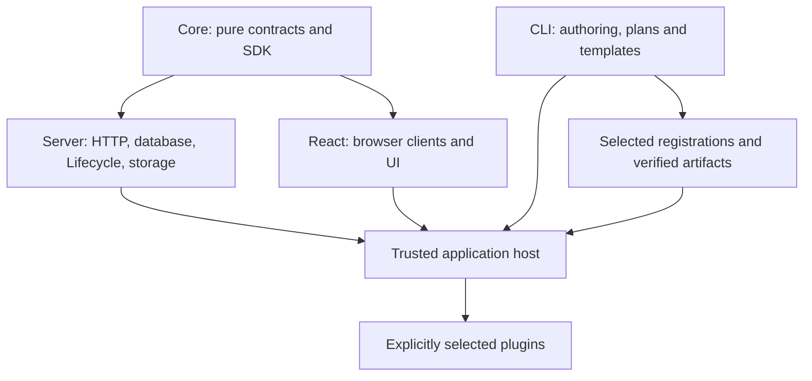

# Compose EAOS packages

## Motivation

EAOS separates feature declarations, host adoption and execution placement. A plugin declares its UI, API, storage contracts and optional native operations; the host selects features and binds trusted adapters. Build success, schema application and tenant activation describe different states.

## Architectural Diagram

| Requirement | Public import | Host responsibility |
| --- | --- | --- |
| Plugin SDK, data contracts and entitlement evaluation | `@alneas/eaos-core` | Verified identity and explicit policy |
| Database, lifecycle, durable CAS, audit and Outbox | `@alneas/eaos-server/db`, `/lifecycle-engine`, `/plugin-data` | Shared transactional stores, migration executors and drain |
| Tenant/plugin file access | `@alneas/eaos-server/storage` | Private provider adapter and live authorization |
| Browser authentication, file transfer and computation | `@alneas/eaos-react/client` | Real authentication, registered native operations and device policy |
| Context, workspace UI and help | `@alneas/eaos-react` | Authenticated context and application API clients |
| Standard approval, field customization and admin | `@alneas/eaos-plugins/approval`, `/field-customization`, `/admin` | Explicit module selection, trusted runtime bindings and separate tenant enablement |
| Generation, diagnostics and deployment planning | `eaos` binary and `@alneas/eaos-cli/platform/operations` | Selected packages, configuration and reviewed operations |

## Trade-offs & Decisions

Core cannot depend on Server or database drivers. The four foundation packages and one optional standard plugin collection share one public monorepo. `@alneas/eaos-plugins` owns three feature modules with separate runtime/frontend outputs; business implementations and production bindings retain separate ownership. Install the collection once, import selected feature subpaths, then separately approve tenant enablement.

Physical schemas are versioned Data Contracts, independently of feature activation. `schemaDependencies` require storage contracts; feature dependencies require services. The public `platformRecordsContract` owns the approval and field-customization envelope. Its historical migration identity is retained. Importing code never creates a table or activates a feature.

Lifecycle validates reviewed plans under a writer lock against current state. It rejects edited/stale plans, changed applied migrations and dirty DDL retries. Active upgrades require all-instance drain. Disable and uninstall preserve data and history; distributed hosts share one durable control store.

HTTP and MCP use host-verified principals, current activation and resource permission. Request bodies cannot grant tenant identity or roles. CAS rejects stale revisions, and business changes share a transaction with audit and Outbox. Storage scopes paths and signed URLs but still requires actual private provider protection.

Native and server placement is explicit. A failed local operation never silently uploads its input. Registered Python or CLI operations are trusted host code, not an operating-system sandbox.

## Application projects and extensions

EAOS is a package system. An application project is still required to run and
deploy it. That project selects packages and features, supplies database and
identity-provider adapters, configures origins and branding, and owns its
listeners, images and deployment state. A reusable plugin is not another
application host.

Tenant-specific extensions are separate private artifacts acquired by the Host.
They retain explicit tenant restrictions, feature admission and their own data
contracts. Repository separation protects source visibility; runtime authorization
protects tenant access. Neither a source-control ignore file nor a hidden menu
provides that runtime boundary.

## Development composition APIs

The following additions are unreleased candidate APIs. Their owning development
guides are intentionally outside default released portal ingestion:

| Assembly responsibility | Candidate entry | Host supplies |
| --- | --- | --- |
| Backend startup and HTTP/MCP connection | `@alneas/eaos-server/host` | Verified authentication/membership, current Lifecycle and entitlement capabilities, selected manifests and route factories |
| Login, header, sidebar and feature presentation | `@alneas/eaos-react/workspace-application` | Existing Appkit provider frame, one authenticated context store, router and branding |
| Connected feature pages | `@alneas/eaos-react/workspace-binding` | Explicit adoption, verified identity, browser transport and feature-specific ports |
| Generated registrations and artifact/build tooling | `@alneas/eaos-cli/platform` | Selected descriptors, output paths, immutable release and resource callbacks |

These APIs compose existing contracts. They do not create an additional identity
store, choose a production provider or authorize a deployment. See the owning
Server, React and CLI source documentation in a candidate checkout for exact
options; match the installed archive rather than guessing an available release.

## Adoption and verification boundaries

`deployment.json` declares components, tasks and verification; `eaos.platform.json` selects targets. Plans and status inspection do not apply changes. Journals record evidence without performing approval, deployment or tenant acceptance.

Before registry publication, use built, checksum-pinned tarballs in isolated consumers. Do not alias sibling source. Public package availability, clean registry installation and deployed host acceptance must be verified separately from local builds.

Continue with [plugin authoring](plugin-authoring.md) and [package verification](testing.md).

See [npm package boundaries and public subpaths](npm-packaging.md) for the publication recommendation and export review gates.
