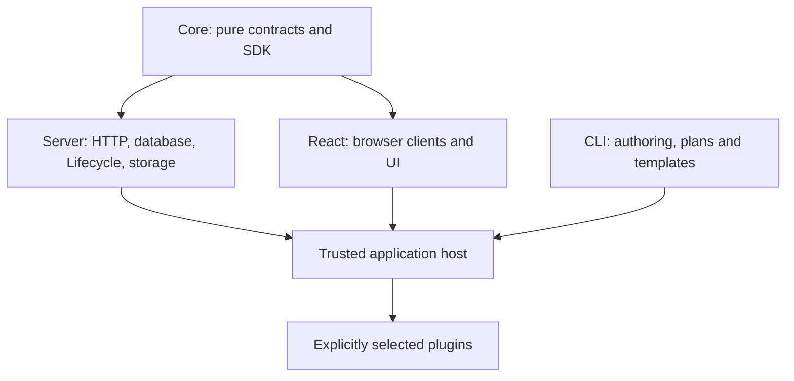

# EAOSを組み合わせる

## 背景と目的

公開契約とホストの実行責任を分け、同じ機能の重複や権限の取り違えを防ぎます。

## 構成図

## トレードオフと判断

EAOSは、機能の宣言、利用アプリでの採用、実行先への配置を分けます。プラグインは必要な画面・API・DB・Native処理を宣言し、利用アプリは採用する機能と実行先を選び、デプロイ処理は配置先ごとにビルド・適用・検証します。

### パッケージの選び方

| 必要な処理 | パッケージ | ホストが用意するもの |
| --- | --- | --- |
| プラグイン契約、認可、共通イベント | eaos-core | 検証済みprincipal、現在の権限、durable監査先 |
| データ契約、JSON文書検証、migrationの集約 | eaos-core | 業務スキーマ、SQL接続、migrationのレビュー |
| 導入・更新・有効化と適用履歴 | eaos-server/lifecycle-engine | 排他付き共有store、migration executor、全instanceのdrain |
| tenant/plugin単位のファイルアクセス | eaos-server/storage | app-coreのprovider adapter、非公開bucket、現在の認可 |
| Hono、HTTPツール、CAS・監査・Outbox | eaos-server | principal resolver、DB transaction、job実行・配信先 |
| Web/LINE/Native接続、ファイル転送 | eaos-react/client | 実認証、登録済みNative操作、端末側filesystem policy |
| Context、record/command画面、共通ヘルプ | eaos-react | 認証済みContext、利用アプリのAPI client、React |
| 雛形、診断、構成生成、配置台帳 | eaos-cli | 採用プラグイン、eaos.platform.json、明示的な操作記録 |

CoreにDB実装やLifecycleを逆参照させません。公開側は単一MonorepoのCore・Server・React・CLIの4パッケージです。DB・Lifecycle・Storageの実装はServer、ブラウザClientはReactが所有します。利用側は必要なパッケージだけを導入できます。業務プラグイン・業務スキーマ・Oracle/Pulumiの具体provider・顧客設定は個別の所有範囲です。

### データ契約と有効化

物理テーブルを提供するDataContractと、機能を提供するpluginは別に版管理します。schemaDependenciesはスキーマの要求を表し、別機能のenableを要求するfeature依存と区別します。installはDB/コードの準備であり、tenantへのenableとは別です。

Lifecycleのplanをレビューし、同じ最新stateに対して排他を取ってapplyします。古いplan、編集されたplan、適用済みmigrationの変更、dirtyなDDLの自動再試行は拒否します。disable/uninstallで顧客データを消しません。複数ホストは同じdurableな制御storeを参照し、更新時には全instanceのdrainをホスト側で実装します。

### HTTP・保存・Nativeの境界

HTTP/MCPツールのtenant・roles・approvalをリクエスト本文から採用しません。検証済みprincipal、現在の有効状態、対象resourceへの権限から判定します。HTTPツールルーターの提供範囲と、標準MCP transportや実認証の接続は区別してください。

保存はCASで古いrevisionを拒否し、監査とOutboxを業務更新と同じtransactionに含めます。Storageはtenant/pluginのprefixを適用し、操作ごとに認可を再確認します。非公開設定は実bucketの保護を代替しないため、providerへの接続時に別途検証します。

Native/serverの実行先はホストが明示します。Native失敗を契機にデータをserverへ転送しません。Python・CLI実行はホストが登録した信頼済み操作であり、任意コードのOS sandboxを提供するものではありません。

### 構成と残作業を確認する

プラグインのdeployment.jsonがcomponent・必要作業・検証要件を宣言し、利用アプリのeaos.platform.jsonで実行先を選びます。同じ完了記録をプラグイン別・配置先別に集計します。構成の確認には公開CLIを使用します。

plan/statusは適用を実行しません。recordは実行結果の証拠を追記する操作で、作業の実行・承認・本番完了を代行しません。build成功、ローカルDB検証、本番適用、tenant有効化、実ホスト受入はそれぞれ別の状態として確認します。

### 未公開版の開発と公開時の確認

公開前は、依存順に作った実tgzを隔離した利用アプリへ導入して確認します。兄弟repoのsrcへのaliasで依存漏れを隠しません。各repoにはビルド・型生成・テスト・公開entryの一覧があり、正確な実行環境のlockfileとSHA-256はローカルの検証receiptに保存されます。

共通ポータルはgithub-docsが所有し、各プロジェクトの公開manifestから一方向に取り込みます。原稿は所有側で修正します。
