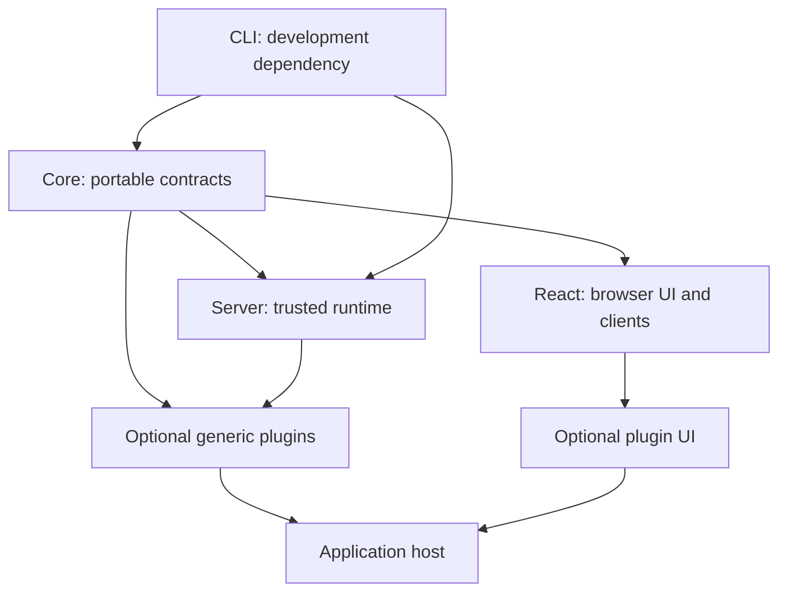

# npm package boundaries and public subpaths

## Motivation

Application authors need a small set of predictable imports without installing server or release tooling in browser applications. The recommended publication layout keeps the existing Core, Server and React runtime packages and distributes CLI tooling separately. The fifth npm package, `@alneas/eaos-plugins`, owns approval, field customization and admin as independently selected modules. The collection was published as 0.1.0. This checkout prepares the independent 0.2.0 React, CLI and collection candidates; candidate metadata does not establish their registry availability.

## Architectural Diagram



Arrows show composition, not permission to import a private implementation. A consuming browser imports React/client entries; it never imports CLI or a Server aggregate.

## Public import

Install package names. Subpaths select entries inside those packages; they are not independently installable packages. These commands require available registry releases. Pre-publication checks use checksum-verified built archives and must not substitute sibling source.

```bash
bun add @alneas/eaos-core @alneas/eaos-server @alneas/eaos-react
bun add @alneas/eaos-plugins
bun add -d @alneas/eaos-cli
```

A browser-only consumer needs the React package and the peers required by its selected features, rather than the entire example above. Server hosts need only their selected server capabilities.

```typescript
import { definePlugin } from '@alneas/eaos-core/plugin-sdk/define-plugin'

export const notes = definePlugin({
  id: 'notes',
  entitlement: { tier: 'public' },
  routes(router) {
    router.post('/ping', async () => ({ ready: true }))
  },
})
```

UI consumers must satisfy React/UI peers and import the chosen UI distribution's stylesheet once. Workspaces require host API/session bindings; portable `@alneas/eaos-react/client` entries require browser APIs but no React provider or CSS. The CLI runs in the development environment, separately from application runtime dependencies.

## Trade-offs & Decisions

### Compare two, three and four foundation packages

| Layout | Consequence | Recommendation |
| --- | --- | --- |
| Two: server/contracts plus React, with tooling folded in | Couples portable schemas to server dependencies or adds tooling to runtime installation. Pure SDK consumers lose an independent dependency boundary. | Avoid for this codebase. |
| Three: Core, Server, React; CLI folded into Server | Retains runtime separation but Server consumers also install compiler/command dependencies and share their release lifecycle. | Use only if a future dependency audit demonstrates a real benefit. |
| Three runtime packages plus a separate CLI | Preserves pure contracts, server implementations and browser UI, with the CLI in devDependencies. | Keep the current four foundation packages. |

A subpath controls module access, not which package dependencies npm installs. Tree shaking does not undo package installation. Use a separate package when runtime, required dependencies, release ownership or optional adoption differ. Use a subpath for features sharing those boundaries. The three standard MIT features share one optional `@alneas/eaos-plugins` package and release lifecycle. Installing it installs its declared package dependencies. Explicit feature imports, isolated outputs and host selection keep runtime loading separate from installation and tenant enablement. The four foundation packages remain independently installable.

### Select a standard plugin module

Install `@alneas/eaos-plugins` once. Import the selected feature explicitly, such as
`@alneas/eaos-plugins/approval/runtime` for trusted server bindings or
`@alneas/eaos-plugins/approval/react` for its frontend. These paths are not npm
package names. The declarative `@alneas/eaos-plugins/catalog.json` lists modules
without importing or activating them.

`preset.plugins` selects logical module owners such as
`@alneas/eaos-plugins/approval`; it does not select the package root or activate a
tenant. Each feature retains its own runtime/frontend inventory and isolated
`dist/<id>/` outputs. Keep feature IDs, authorization, schema and migration
identities unchanged when adopting the shared archive. The three former plugin
package names were unpublished; the published collection replaces them rather than
publishing compatibility packages.

See the [collection architecture](../plugins/docs/architecture.md) for ownership
and opt-in boundaries.

### Prefer feature entries over implementation filenames

The current foundation manifests expose 68 Core, 73 Server, 19 React and 39 CLI entries, including schema/help assets. Each exported path creates a consumer contract. Review that surface before the first registry release; do not infer public imports from the source tree.

| Package | Existing feature entries to prefer in guides | Boundary |
| --- | --- | --- |
| `@alneas/eaos-core` | root, `/plugin-sdk/define-plugin`, `/data-contracts`, `/entitlements`, `/testing` | Portable contracts and pure helpers; no Server dependency. |
| `@alneas/eaos-server` | `/plugin-sdk`, `/db`, `/lifecycle-engine`, `/storage`, `/entitlements`, `/plugin-data`, `/mcp` | Trusted server runtime and host capabilities. The current manifest has no root entry. |
| `@alneas/eaos-react` | `/client`, `/client/compute`, `/plugin-runtime`, `/plugin-gate`, `/record-workspace`, `/command-workspace`, `/snapshot-workspace` | Browser/client or React behavior; no backend SDK or credentials. |
| `@alneas/eaos-cli` | `/dev`, `/baseline`, `/platform/operations`, `/platform/deployment-assets` | Programmatic development tools. Run commands through the `eaos` binary; the package root starts the CLI parser. |
| `@alneas/eaos-plugins` | `/approval`, `/field-customization`, `/admin`, and each feature's declared `/manifest`, `/runtime`, `/react` entries | No root runtime barrel. Keep server factory, metadata, trusted loader and UI explicit. |

Use explicit `exports` entries with `types` before `import`, mapped to shipped declarations and JavaScript. Keep extensionless consumer paths consistent. Do not add `./*`, `/src/*` or `/dist/*` patterns: they expose implementation layout and make future refactoring a breaking change. JSON/schema/help resources need explicit asset entries and must be present in the packed files.

A future shortening such as `/lifecycle` should first be proposed as a canonical name, then implemented as a forwarding entry to the same implementation. Inventory consumers before removing an existing name. Do not silently promise such an alias in guides before it exists. Retain a compatibility entry for already distributed consumers until an intentional breaking release; do not copy its implementation.

### Publication gates

1. Use public `@alneas/appkit-core` ^0.2.2 and `@alneas/appkit-react` ^0.3.1 with Node.js 24 or later. Resolve every used symbol against the actual npmjs artifact and verify real archive consumers; a package rename alone is insufficient. Follow [the contributor checks](../CONTRIBUTING.md) and [release preparation](../RELEASING.md).
2. Inventory every export as canonical, compatibility, host-extension or asset. Decide the supported surface before removing any entry, and keep Changesets and consumer coverage with API changes.
3. Make browser, server and CLI entry graphs independent. Do not rely on optional peers to make an unconditional backend import browser-safe. Keep React/context dependencies as compatible peers to prevent duplicate contexts. Add CommonJS only if its declarations and runtime are actually built and verified; current foundation manifests advertise ESM imports.
4. Review `files`, license/notices, repository metadata and package README presentation. Keep portal metadata in a generated landing page when preparing plain npm/GitHub READMEs. API cards, machine indexes and feature-guide examples must agree with the final exports.
5. Inspect packed files, then install the built packages into isolated server and browser consumers with TypeScript's ordinary module resolution. Verify named exports, assets, browser bundling and optional-feature loading. After releases exist, repeat from npmjs with a clean lockfile and no local overrides. A successful local archive test is separate evidence from registry availability.

No npm publication, source push, deployment or tenant activation is performed by this guide.

The entry-point rules follow [Node.js package exports](https://nodejs.org/api/packages.html#package-entry-points). Dependency, peer and packed-file behavior follows the [npm package manifest reference](https://docs.npmjs.com/cli/v11/configuring-npm/package-json/).

Continue with [composition boundaries](architecture.md), [package verification](testing.md) and [documentation maintenance](documentation.md).
