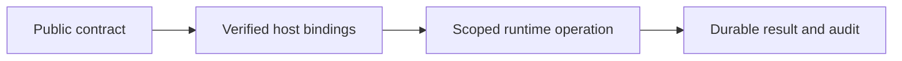

# CLI boundaries

## Motivation

Plugin authoring, diagnostics, configuration generation, baseline compilation and deployment templates. Business plugins, customer data, credentials, actual infrastructure settings and operator receipts remain outside this public package.

## Architectural Diagram



## Public import

Install the package; the subpath below is an import target, not a separate package. Registry installation requires a published EAOS release; before publication use the owning workspace's checksum-verified build artifact.

```bash
bun add @alneas/eaos-cli
```

```typescript
import { baselineImages } from '@alneas/eaos-cli/baseline'

export const requiredImages = baselineImages
```

Development tooling only; use Bun for the CLI. Database baseline compilation additionally needs the local Docker/image setup described in the baseline guide.

## Trade-offs & Decisions

The host supplies verified identity and current lifecycle/resource authorization. CAS rejects stale revisions; durable host stores retain audit and Outbox. Provider connections and secrets are injected through trusted ports.

Code installation, database/infrastructure application and tenant activation are separate operations. Import/build/test/install do not perform production migrations or infrastructure updates. Before registry publication, build and test checksum-pinned tarballs in isolated consumers instead of linking sibling source.

See [plugin development](plugin-dev.md), [tiers](plugin-tiers.md), [OCI release](oci-release.md) and [verified baselines](baseline.md).
