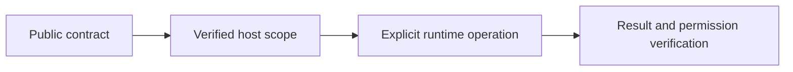

# Declarative plugin SDK

## Motivation

Keep portable declarations separate from trusted host execution, current access checks and durable effects.

## Architectural Diagram



## Public import

Install the package; the subpath below is an import target, not a separate package. Registry installation requires a published EAOS release; before publication use the owning workspace's checksum-verified build artifact.

```bash
bun add @alneas/eaos-core
```

```typescript
import { definePlugin } from '@alneas/eaos-core/plugin-sdk/define-plugin'

export const defineFeature = definePlugin
```

This entry has no Server implementation dependency. The host supplies scoped database/storage capabilities and current authorization.

## Trade-offs & Decisions

`definePlugin` is exported from the package root and `@alneas/eaos-core/plugin-sdk/define-plugin`. A definition contains routes, optional schema dependencies and an explicit `entitlement` policy. It has no server, database-driver or Lifecycle dependency.

```typescript
import { definePlugin } from '@alneas/eaos-core'

export default definePlugin({
  id: 'notes',
  entitlement: { tier: 'pro', addonId: 'addon-notes' },
  routes(router) {
    router.post<{ id: string }>('/read', async (ctx, input) => {
      return ctx.db.findOne('notes', input.id)
    })
  },
})
```

The server binds verified identity to `ctx.principal` and supplies scoped app-core adapters through `ctx.db` and `ctx.storage`, plus secrets, jobs, webhook verification, audit and explicitly registered services. The host must enforce current permissions on each capability operation; wrapping an unrestricted administrative adapter does not make it tenant-safe. `db` retains the app-core `find`, `findOne`, `create`, `update` API. CAS, contract validation and namespace-safe `plugin_data` changes use the existing EAOS host services; the SDK does not silently add those guarantees to arbitrary adapters.

Policy tiers are `public`, `standard`, `pro`, and `corporate`. Pro requires an explicit addon grant and an active non-free subscription; a Pro plan alone does not grant every addon. Corporate requires `allowedTenants`. Optional metering has a stable `unit` and nonnegative `defaultMonthlyQuota`. Quota overrides are keyed by addon ID, otherwise plugin ID. Zero allows no executions. Expiry is an exclusive UTC timestamp. The legacy manifest `tier` field is unchanged; commercial policy is declared separately in `entitlement`.

`@alneas/eaos-core/entitlements` is browser-safe. `evaluatePluginEntitlement` is a pure UI/host preview, not an authorization token. Server-side admission must read current contracts.

`@alneas/eaos-core/testing` exports `createPluginTestHarness`. Stateless routes work without a database. For persistence, pass `createContext` using the real scoped adapters under test. Configure `isolationProbe` to create a record as one tenant and assert a foreign tenant cannot read it, then call `expectTenantIsolation()`. It rejects missing probes instead of claiming isolation from a manifest alone. This pure harness does not test HTTP authentication, metering, role admission or production RLS; use the server router and packed consumer tests for those boundaries.

The canonical public package is `@alneas/eaos-core` in the four-package EAOS monorepo.
