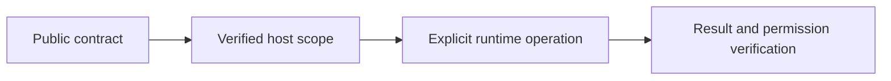

# Client computation

## Motivation

Keep portable declarations separate from trusted host execution, current access checks and durable effects.

## Architectural Diagram



## Public import

Install the package; the subpath below is an import target, not a separate package. Registry installation requires a published EAOS release; before publication use the owning workspace's checksum-verified build artifact.

```bash
bun add @alneas/eaos-react
```

```typescript
import { createWorkerPluginExecutor } from '@alneas/eaos-react/client/compute'

export function bindCompute(createWorker: Parameters<typeof createWorkerPluginExecutor>[0]) {
  return createWorkerPluginExecutor(createWorker)
}
```

Run in a browser with Worker support. No React provider or CSS is required by this entry. Supply the Worker factory and operation allowlist, and close the executor when its authenticated session ends.

## Trade-offs & Decisions

`createPluginInvoker` supports explicit `wasm`, `browser-ai`, `native` and `server` placements. A failure never changes placement or uploads input automatically.

`@alneas/eaos-react/client/compute` supplies `createWorkerPluginExecutor` and `installComputeWorker`. Create a Worker per authenticated client scope, register exact `plugin:action` handlers, and close the executor on logout or tenant change. Requests are correlated by IDs; cancellation, worker crashes and timeout reject outstanding calls and terminate the Worker. A subsequent call can create a fresh Worker unless the executor was closed. Cancellation affects every call sharing that Worker.

Obtain private model/WASM asset metadata through an authenticated server endpoint, then call `fetchVerifiedComputeAsset`. The loader fetches a signed URL without cookies, refuses redirects and verifies SHA-256 before returning bytes. Signed storage URLs need suitable CORS configuration. Local HTTP is accepted only on loopback for development.

`loadGoCompute` instantiates bytes using a host-supplied matching Go `wasm_exec.js` runtime and explicit readiness/invocation bridge. `loadBrowserAiCompute` selects WebGPU/WASM providers through a supplied ONNX session factory. Run these loaders inside the registered Worker; they do not turn an arbitrary Go HTTP server into browser-compatible code. Plugins own tensor preprocessing, result serialization and actual WASM/model artifacts. These adapters do not include migrated private calculations or a trained model, and do not promise a fixed execution time.
