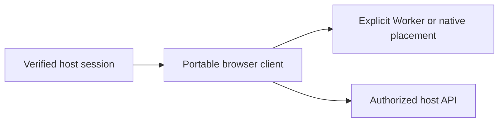

# Portable browser client boundaries

## Motivation

Portable clients provide browser authentication integration, context, transfer and registered computation without depending on React components. They belong to `@alneas/eaos-react/client`.

## Architectural Diagram



## Public import

Install the package; the subpath below is an import target, not a separate package. Registry installation requires a published EAOS release; before publication use the owning workspace's checksum-verified build artifact.

```bash
bun add @alneas/eaos-react
```

```typescript
import { createFileDownloader } from '@alneas/eaos-react/client'

export const downloadFile = createFileDownloader({ maxBytes: 1024 * 1024 })
```

Browser APIs are required for the default downloader. This portable client entry does not require a React provider or stylesheet; native saving requires a host-supplied adapter.

## Trade-offs & Decisions

The host supplies real authentication, current access and native operation catalogs. Build-time routes do not activate features. Devices independently enforce filesystem and executable policy. A local failure never silently changes execution placement.

Use cancellation and session revision checks to discard stale responses. Keep model/runtime assets private when required and validate their integrity before execution. See [client computation](compute.md) and the [API reference](api.md).
