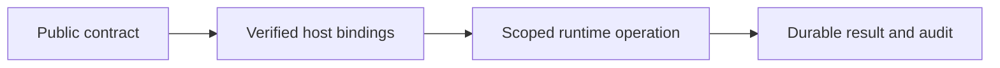

# React and browser boundaries

## Motivation

Authenticated React UI, portable browser clients, workspace definitions and shared help. Business plugins, customer data, credentials, actual infrastructure settings and operator receipts remain outside this public package.

## Architectural Diagram



## Public import

Install the package; the subpath below is an import target, not a separate package. Registry installation requires a published EAOS release; before publication use the owning workspace's checksum-verified build artifact.

```bash
bun add @alneas/eaos-react
```

```typescript
import { titleRecordSchema } from '@alneas/eaos-react/record-workspace'

export const schema = titleRecordSchema({
  type: 'object', properties: { title: { type: 'string' } },
}, { title: 'Title' })
```

React UI requires compatible React, react-tools and lucide-react peers from the package manifest. Import the installed UI distribution's stylesheet at the application boundary; workspaces require their host API/session bindings.

## Trade-offs & Decisions

The host supplies verified identity and current lifecycle/resource authorization. CAS rejects stale revisions; durable host stores retain audit and Outbox. Provider connections and secrets are injected through trusted ports.

Code installation, database/infrastructure application and tenant activation are separate operations. Import/build/test/install do not perform production migrations or infrastructure updates. Before registry publication, build and test checksum-pinned tarballs in isolated consumers instead of linking sibling source.

Use `record-workspace` for independent records, `command-workspace` for aggregate state and one selected command, and `snapshot-workspace` for aggregate lists/details with multiple commands. Definitions own labels, fields, conversions and domain-specific rendering; do not copy generic screens.

Empty numeric input remains `NaN`, not zero. Server validation still enforces numeric types/ranges. `titleRecordSchema` adds presentation labels without changing the canonical schema. `createWorkspaceClientBindings` connects typed clients to existing snapshot/session boundaries. `useWorkspaceTask` suppresses duplicate UI submissions and stale responses; unmounting does not undo completed server work. Reload after uncertain failures.


DOM tests exercise save/reload, input, previews, revocation and delayed responses. Coverage is not a measure of production identity or complete end-to-end UI acceptance. See [plugin runtime](plugin-runtime.md) and [browser computation](client/docs/compute.md).
