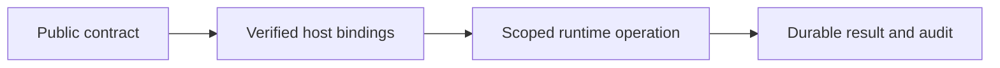

# eaos-react 開発と境界

## 背景と目的

公開契約とホストの実行責任を分け、同じ機能の重複や権限の取り違えを防ぎます。

## 構成図

## トレードオフと判断

### 所有範囲

現在の認証状態を使うReact UI・共通ヘルプ。業務plugin・業務物理schema・顧客データ・秘密値・実環境設定・運用receiptは含めません。

### 開発

EAOS依存がまだ未公開の場合は、workspaceのビルド入口を使います。先行パッケージをtgzにして隔離環境へ導入し、型生成・テスト・packの成功後だけ最新receiptを更新します。

### 認可・永続化

tenant/user/rolesは検証済みホストから渡します。Lifecycleの有効状態とresource権限を実行時に再確認します。CASは古いrevisionを拒否し、監査/Outboxはホストがdurableなstoreへ保存します。SQL接続・provider資格情報はホストから注入します。

### 配布と適用

コードの導入、DB/infra適用、tenant有効化は別操作です。build/test/installは本番migrationやPulumi updateを実行しません。共通ドキュメントサイトの原稿はこのrepoのdocsが正本です。

### 共通画面の使い分け

`record-workspace` は独立レコードの一覧・作成・編集・業務コマンド用です。`command-workspace` は集約状態と選択した操作フォーム、`snapshot-workspace` は集約の一覧・詳細と複数の操作フォームを表示します。画面をコピーせず、プラグインのdefinitionに操作・項目・表示名を置きます。案件ID、編集ロック、入力変換、BIM属性・人事資格等の固有表示もdefinitionの責務です。

`workspace-fields` の数値欄は空入力をNaNとして扱い、未入力の金額を0に変えません。数値の範囲・型はサーバーでも検証してください。`titleRecordSchema` は正本schemaを変更せず表示名を加えます。

rootの `createWorkspaceClientBindings` は業務固有の型付きclientを既存のsnapshot/session境界に接続します。`useWorkspaceTask` はUIの二重送信と古い応答の反映を抑止します。接続切替・unmountによる表示上の破棄は、実行済みのサーバー処理を取り消しません。失敗時は最新状態を再取得して確定状態を確認します。これらの部品は認証、durable queue、業務トランザクションを新設しません。

### 品質確認

`bun test --coverage` はDOMを先に初期化し、作成・編集・検索・プレビュー・再読込・二重送信・権限失効・遅延応答を操作します。happy-domは開発依存です。行カバレッジは本番認証やすべての画面のE2E受入率を意味しません。

See [Fail-closed plugin access gates and session-bound API/compute hooks](../plugin-runtime.md) for the architecture additions and their host boundaries.
