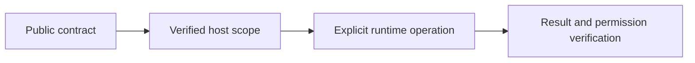

# Plugin access and execution

## Motivation

Keep portable declarations separate from trusted host execution, current access checks and durable effects.

## Architectural Diagram



## Public import

Install the package; the subpath below is an import target, not a separate package. Registry installation requires a published EAOS release; before publication use the owning workspace's checksum-verified build artifact.

```bash
bun add @alneas/eaos-react
```

```typescript
import { usePluginCompute } from '@alneas/eaos-react/plugin-runtime'

export function useSimulation() {
  const compute = usePluginCompute('example')
  return (months: number) => compute<{ total: number }>('simulate', { months })
}
```

Use inside React with PluginRuntimeProvider bound to the authenticated session, API transport and explicit compute invoker. PluginGate additionally uses the authenticated tenant context. Hooks do not supply authentication.

## Trade-offs & Decisions

`PluginGate` renders only when the existing authenticated tenant store has both the plugin's enabled module and `pluginAccess[pluginId].allowed === true`. Loading/error/cleared context fails closed. A missing or tenant-locked entry renders nothing by default; subscription/addon/quota denials render a plan message. Supply a custom fallback for host billing links. The host refreshes decisions from current server contracts; the gate provides presentation only.

`PluginRuntimeProvider` binds an authenticated `tenantId`, changing `sessionKey`, API transport and compute invoker. `usePluginApi(pluginId)` returns a request function; `usePluginCompute(pluginId)` returns a compute function. Both take `(operation, input)` and accept a generic result type. The host transport owns CSRF/session headers, HTTP methods, request validation and the explicit compute placement catalog. Changing runtime/session/plugin scope aborts prior calls and rejects late responses even when a transport ignores cancellation. Close the underlying Worker executor when ending the session.

```tsx
import { usePluginCompute } from '@alneas/eaos-react/plugin-runtime'

export function useQuantSimulation() {
  const compute = usePluginCompute('quant')
  return (months: number) => compute<{ total: number }>('simulate', { months })
}
```
