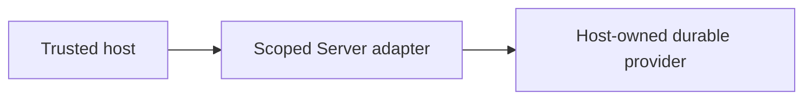

# Db ownership and host boundaries

## Motivation

Data Contract ownership, JSON document validation, schema composition and SQLite adapters. This capability belongs to `@alneas/eaos-server`; it is not a separate npm package.

## Architectural Diagram



## Public import

Install the package; the subpath below is an import target, not a separate package. Registry installation requires a published EAOS release; before publication use the owning workspace's checksum-verified build artifact.

```bash
bun add @alneas/eaos-server
```

```typescript
import { LocalFirstSqliteAdapter } from '@alneas/eaos-server/db/local-first-sqlite-adapter'

export type LocalDatabaseOptions = ConstructorParameters<typeof LocalFirstSqliteAdapter>[0]
```

Server runtime only. The host supplies the database connection and independently enforces tenant/resource authorization.

## Trade-offs & Decisions

`LocalFirstSqliteAdapter` manages a local cache and Outbox. Failed begin/commit operations are not success; pull failures attempt rollback and report uncertainty. Null filters use `IS NULL`; zero limits and offset-only pagination retain their meaning. Invalid pagination and unsupported filters are rejected.

Bind the SQLite driver and upstream to the same authorization scope and separate local tenant databases. An inserted default tenant ID is not RLS or runtime authorization. Durable business state, CAS and final authorization remain host-owned. Local enqueue and external delivery are not an exactly-once transaction.

The host owns verified identity, tenant boundaries, credentials and real provider adoption. Package builds and tests never apply production changes or activate tenants. Review the [API reference](api.md) before binding the host.
