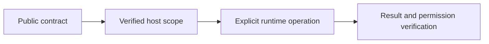

# Live plugin contracts and metering

## Motivation

Keep portable declarations separate from trusted host execution, current access checks and durable effects.

## Architectural Diagram



## Public import

Install the package; the subpath below is an import target, not a separate package. Registry installation requires a published EAOS release; before publication use the owning workspace's checksum-verified build artifact.

```bash
bun add @alneas/eaos-server
```

```typescript
import { PluginEntitlementRuntime } from '@alneas/eaos-server/entitlements'

export function bindEntitlements(options: ConstructorParameters<typeof PluginEntitlementRuntime>[0]) {
  return new PluginEntitlementRuntime(options)
}
```

Server runtime only. Supply the live contract loader, lifecycle admission and a shared durable atomic repository; importing does not create the control tables.

## Trade-offs & Decisions

`@alneas/eaos-server/entitlements` exports `PluginEntitlementRuntime`, `createPluginEntitlementGuard`, `createPluginAssetRouter`, `tenantEntitlementContract` and `createSqlTenantEntitlementLoader`. Install the control contract through reviewed Lifecycle operations; importing it never creates a table. The SQL loader reads `eaos_tenant_entitlements` from the primary control database. Host administration authorizes grants and expiry policy; contract writes must retain CAS and durable audit. The framework does not issue payments or subscriptions.

Construct a runtime with the loader, current Lifecycle admission callback and a shared `AtomicRepository`. Every admitted metered attempt reserves one unit in a UTC calendar-month bucket and appends the existing durable atomic audit chain in the same transaction. A failed audit write rolls back the reservation. A handler failure still counts its admitted attempt. Retries count separately; business command idempotency does not deduplicate admission. Discovery and asset URL requests do not consume execution units. Repository CAS conflicts fail closed; callers must not blindly retry a business operation.

Pass the runtime as `createApp({ entitlements, resolveEntitlementPrincipal })`. An explicitly declared policy cannot be bypassed by disabling the legacy module guard or using development mode. A missing runtime returns 503 on HTTP; unmet subscriptions/addons/quotas return 402; a foreign Corporate tenant receives 404 before module checks. Existing manifests without `entitlement` retain their previous authorization behavior.

MCP discovery filters current contracts. Both execute and JSON-RPC calls check the contract before constructing dependencies and reserve quota immediately before the handler. JSON-RPC errors contain the HTTP-equivalent status in `error.data.status`.

Jobs and verified webhooks must use the same runtime's `run(principal, pluginId, rule, operation, callback)` in addition to their host authentication/resource checks. Never derive the principal or policy from a job payload. Existing direct service method calls do not automatically gain entitlement checks.

`createSdkPluginRouter` in `@alneas/eaos-server/plugin-sdk` mounts a Core `definePlugin` definition. It requires a principal resolver, a current lifecycle/resource authorization callback and a scoped context factory. Identity cannot be overridden by the factory or request body. JSON bodies are bounded to 1 MiB; route-specific input validation remains the plugin's responsibility. Browser hosts still supply their established CSRF/Origin middleware.

The asset router accepts only a trusted catalog and signing callback. It rechecks admission after signing, returns `private, no-store` metadata and limits the requested lifetime to 60 seconds. The signing adapter must enforce that lifetime and private storage. A copied signed URL can remain usable until expiry, and authorized browsers can read downloaded bytes; this is access control, not DRM. WASM and ONNX assets must not also be served from a public directory.

For React, merge current runtime decisions into the authenticated context's `pluginAccess` map and refresh it on contract/session changes. Omit foreign Corporate plugins completely. UI gates never replace backend admission.

The new common update/admin factories are documented separately in the
[development Host account-service guide](https://github.com/dataarthub/eaos/blob/main/packages/server/docs/development/host-account-services.md).
Their source-candidate status does not establish registry availability.
