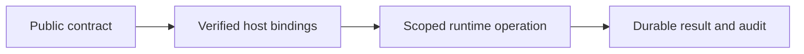

# Server boundaries

## Motivation

Hono/MCP, identity integration, durable CAS/audit/Outbox, lifecycle, database and scoped storage implementations. Business plugins, customer data, credentials, actual infrastructure settings and operator receipts remain outside this public package.

## Architectural Diagram



## Public import

Install the package; the subpath below is an import target, not a separate package. Registry installation requires a published EAOS release; before publication use the owning workspace's checksum-verified build artifact.

```bash
bun add @alneas/eaos-server
```

```typescript
import { createSdkPluginRouter } from '@alneas/eaos-server/plugin-sdk'

export const bindSdkRouter = createSdkPluginRouter
```

Server runtime only. Install the package's Hono dependency and provide verified identity, scoped context and current authorization.

## Trade-offs & Decisions

The host supplies verified identity and current lifecycle/resource authorization. CAS rejects stale revisions; durable host stores retain audit and Outbox. Provider connections and secrets are injected through trusted ports.

Code installation, database/infrastructure application and tenant activation are separate operations. Import/build/test/install do not perform production migrations or infrastructure updates. Before registry publication, build and test checksum-pinned tarballs in isolated consumers instead of linking sibling source.

See [live entitlements](entitlements.md), [database boundaries](db/docs/guide.md), [lifecycle](lifecycle/docs/guide.md) and [storage](storage/docs/guide.md).


## Shared model execution

`@alneas/eaos-server/execution/chat` owns generic chat orchestration and
`@alneas/eaos-server/execution/tool-agent` owns bounded read-tool orchestration
and unexecuted write handoffs. Appkit Core 0.2.0 owns HTTP/SSE and Action execution.
Hosts retain model endpoints, credentials, tool registration, live permission,
model bindings, budgets and durable accounting. Domain prompts, extraction schemas,
account mappings and the proposal/approval/save composition belong to plugins.

The built-in LiteLLM worker uses this same chat API with the existing endpoint,
model and fetch options. `litellmHeaders` supplies Host credentials; `chat` supplies
shared policies and adapters. Injected executors still run first. Goose/Hermes remain
process adapters. Worker text output limits remain distinct from serialized stream
event limits. Optional `runTask` cancellation applies to built-in chat; existing
process and injected-executor cancellation contracts are unchanged.

LiteLLM requests SSE (`stream: true`). A custom JSON-only endpoint must supply a
compatible `AIChatAdapter` or an injected executor; no parallel provider parser is
provided. A configured model registry requires explicit `modelAdapters` bindings
for its model IDs. Host parameters cannot replace `model`, `messages`, `tools` or
`stream`. Unknown usage is passed to the existing accounting port for reconciliation;
Appkit's OpenAI-compatible adapter does not expose provider SSE token-usage fields.
This integration does not estimate them or silently record zero.

```typescript
import { createChatClient, type ChatClientOptions } from '@alneas/eaos-server/execution/chat';
import { createToolAgent, type ToolAgentOptions } from '@alneas/eaos-server/execution/tool-agent';

export function connectChat(options: ChatClientOptions) {
  return createChatClient(options);
}

export function connectReadAgent(options: ToolAgentOptions) {
  return createToolAgent(options);
}
```

Read-tool descriptors and retained tool results are reauthorized before model
disclosure. Write requests remain handoffs to the existing Action/Proposal approval
path. Provider errors, incomplete streams, cancellation, policy revocation and
oversized output reject before an authorized response is returned. A transport
fixture integration test is distinct from a live model/provider acceptance test.
