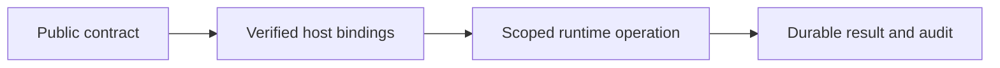

# Server boundaries

## Motivation

Hono/MCP, identity integration, durable CAS/audit/Outbox, lifecycle, database and scoped storage implementations. Business plugins, customer data, credentials, actual infrastructure settings and operator receipts remain outside this public package.

## Architectural Diagram



## Public import

Install the package; the subpath below is an import target, not a separate package. Registry installation requires a published EAOS release; before publication use the owning workspace's checksum-verified build artifact.

```bash
bun add @alneas/eaos-server
```

```typescript
import { createSdkPluginRouter } from '@alneas/eaos-server/plugin-sdk'

export const bindSdkRouter = createSdkPluginRouter
```

Server runtime only. Install the package's Hono dependency and provide verified identity, scoped context and current authorization.

## Trade-offs & Decisions

The host supplies verified identity and current lifecycle/resource authorization. CAS rejects stale revisions; durable host stores retain audit and Outbox. Provider connections and secrets are injected through trusted ports.

Code installation, database/infrastructure application and tenant activation are separate operations. Import/build/test/install do not perform production migrations or infrastructure updates. Before registry publication, build and test checksum-pinned tarballs in isolated consumers instead of linking sibling source.

See [live entitlements](entitlements.md), [database boundaries](db/docs/guide.md), [lifecycle](lifecycle/docs/guide.md) and [storage](storage/docs/guide.md).
