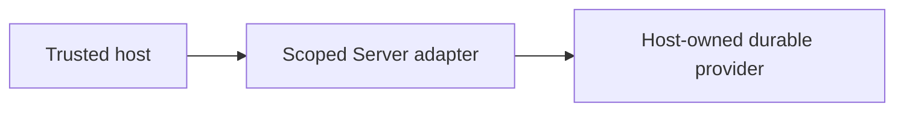

# eaos-db 開発と境界

## 背景と目的

公開契約とホストの実行責任を分け、同じ機能の重複や権限の取り違えを防ぎます。

## 構成図

## トレードオフと判断

### 所有範囲

DataContract・JSON文書検証・schema集約・SQLite接続。業務plugin・業務物理schema・顧客データ・秘密値・実環境設定・運用receiptは含めません。

### 開発

EAOS依存がまだ未公開の場合は、workspaceのビルド入口を使います。先行パッケージをtgzにして隔離環境へ導入し、型生成・テスト・packの成功後だけ最新receiptを更新します。

### 認可・永続化

tenant/user/rolesは検証済みホストから渡します。Lifecycleの有効状態とresource権限を実行時に再確認します。CASは古いrevisionを拒否し、監査/Outboxはホストがdurableなstoreへ保存します。SQL接続・provider資格情報はホストから注入します。

### 配布と適用

コードの導入、DB/infra適用、tenant有効化は別操作です。build/test/installは本番migrationやPulumi updateを実行しません。共通ドキュメントサイトの原稿はこのrepoのdocsが正本です。

### SQLiteの同期と検索

`LocalFirstSqliteAdapter` はローカルキャッシュとOutboxを扱います。`pullChanges` のBEGIN/COMMIT失敗は成功扱いせず、同期失敗ではROLLBACKを試行し、確定できなければエラーを返します。`NULL` は `IS NULL` で検索し、`limit:0` とoffsetのみの指定も保持します。負数・小数・文字列のページ指定、未対応のfilter演算子は明示的に拒否します。

SQLite driverとupstreamはホストが同じ認可範囲へ束縛し、ローカルDBはtenantごとに分離してください。`tenantId` による挿入時の既定値は、共有SQLiteに対するRLSや実行時認可を提供しません。業務の正本・CAS・最終認可にはホストのdurable repositoryを利用します。Outboxのローカル変更・enqueue全体や外部処理のexactly-onceを保証する部品ではありません。

### 検証

直接テストでは契約の所有権・依存循環・版範囲・移行順序と実SQLiteのCRUD、offline再試行、拒否時の復元、SCNのロールバック、listener終了を確認します。DDL生成は文字列検証であり、本番Oracle/PostgresのRLS/VPDや接続試験ではありません。
