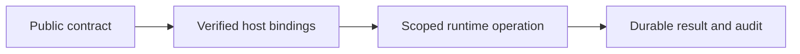

# eaos-server 開発と境界

## 背景と目的

公開契約とホストの実行責任を分け、同じ機能の重複や権限の取り違えを防ぎます。

## 構成図

## トレードオフと判断

### 所有範囲

Hono/MCP・認証接続・永続CAS/監査/Outbox・job実行。業務plugin・業務物理schema・顧客データ・秘密値・実環境設定・運用receiptは含めません。

### 開発

EAOS依存がまだ未公開の場合は、workspaceのビルド入口を使います。先行パッケージをtgzにして隔離環境へ導入し、型生成・テスト・packの成功後だけ最新receiptを更新します。

### 認可・永続化

tenant/user/rolesは検証済みホストから渡します。Lifecycleの有効状態とresource権限を実行時に再確認します。CASは古いrevisionを拒否し、監査/Outboxはホストがdurableなstoreへ保存します。SQL接続・provider資格情報はホストから注入します。

### 配布と適用

コードの導入、DB/infra適用、tenant有効化は別操作です。build/test/installは本番migrationやPulumi updateを実行しません。共通ドキュメントサイトの原稿はこのrepoのdocsが正本です。

See [Live HTTP/MCP subscription admission, atomic monthly metering, private asset signing and SDK context injection](../entitlements.md) for the architecture additions and their host boundaries.
