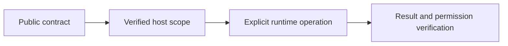

# Data Contract baselines

## Motivation

Keep portable declarations separate from trusted host execution, current access checks and durable effects.

## Architectural Diagram



## Public import

Install the package; the subpath below is an import target, not a separate package. Registry installation requires a published EAOS release; before publication use the owning workspace's checksum-verified build artifact.

```bash
bun add @alneas/eaos-server
```

```typescript
import { createDataContractBaseline } from '@alneas/eaos-server/lifecycle-engine/baseline'

export const describeBaseline = createDataContractBaseline
```

Server tooling only. Descriptor creation does not verify SQL equivalence or rebase an installed ledger; those are separate reviewed operations.

## Trade-offs & Decisions

`createDataContractBaseline(source, version, finalSql)` creates an immutable descriptor with source and target contracts, source migration IDs/positions/checksums and an integrity hash. The new contract version must increase, every original SQL dialect must remain represented and all replaced migrations must be database-scoped. The supplied SQL must describe the final schema, rather than a concatenated history. Provider tooling owns SQL equivalence review.

`rebaseDataContractBaseline(store, databaseId, descriptor, { expectedRevision, quiesce })` runs under the existing exclusive Lifecycle writer lock. It checks the complete installed source contract and every applied checksum, scope and position. Partial, dirty, modified or stale history is rejected. Installed consumers must accept the target contract version. Active consumers require an all-instance drain callback and are disabled before the ledger changes.

No DDL runs during rebase. Old records and the exact source contract remain in `LifecycleState.baselineHistory`. The current migration ledger advances to the baseline; the installed Data Contract advances to the target. New hosts execute the target's final DDL normally. Existing hosts rebased against matching history skip it. A second unrelated apply still uses ordinary plan/review/revision rules. Preserve the baseline descriptor and archived source with the release.

The CLI's `db:baseline` automatically compiles SQLite, PostgreSQL and Oracle schema histories in fresh local databases and verifies an independent rebuild. It retains the archived contract, complete replaced-history checksums and compiler evidence. PostgreSQL/Oracle require checksum-pinned local Docker images; no production DSN is accepted. Generation is separate from ledger rebase. Unsupported object classes are rejected rather than silently omitted. See the CLI baseline guide for compiler boundaries.
