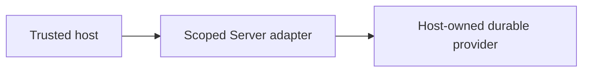

# Lifecycle ownership and host boundaries

## Motivation

Installation, upgrades, activation, migration history, placement and completion evidence. This capability belongs to `@alneas/eaos-server`; it is not a separate npm package.

## Architectural Diagram



## Public import

Install the package; the subpath below is an import target, not a separate package. Registry installation requires a published EAOS release; before publication use the owning workspace's checksum-verified build artifact.

```bash
bun add @alneas/eaos-server
```

```typescript
import { resolveDataContracts } from '@alneas/eaos-server/lifecycle-engine'

export const resolveHostContracts = resolveDataContracts
```

Server runtime only. Supply durable lifecycle state, exclusive writer locking and reviewed host executors before applying a plan.

## Trade-offs & Decisions

Apply only a reviewed current plan under an exclusive writer lock. Active upgrades require all-instance drain. Shared hosts use one transactional control store. Disable/uninstall retain data and history. Dirty DDL requires reconciliation rather than blind retry or automatic lock expiry.

See [baseline descriptors](baseline.md) for integrity-pinned, non-DDL ledger rebase with retained source history.

The host owns verified identity, tenant boundaries, credentials and real provider adoption. Package builds and tests never apply production changes or activate tenants. Review the [API reference](api.md) before binding the host.
