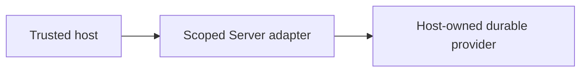

# Storage ownership and host boundaries

## Motivation

Tenant/plugin-scoped storage and signed-URL authorization. This capability belongs to `@alneas/eaos-server`; it is not a separate npm package.

## Architectural Diagram



## Public import

Install the package; the subpath below is an import target, not a separate package. Registry installation requires a published EAOS release; before publication use the owning workspace's checksum-verified build artifact.

```bash
bun add @alneas/eaos-server
```

```typescript
import { createTenantStorage } from '@alneas/eaos-server/storage'

export function bindStorage(...args: Parameters<typeof createTenantStorage>) {
  return createTenantStorage(...args)
}
```

Server runtime only. Supply the external storage adapter and verified tenant/plugin scope with live authorization; provider credentials stay on the server.

## Trade-offs & Decisions

Reuse the app-core storage adapter. Verified scopes, private provider settings and live per-operation permission are mandatory. A signed URL can remain usable until expiry; downloaded bytes cannot be remotely revoked. Validate real bucket protection separately from a configuration flag.

The host owns verified identity, tenant boundaries, credentials and real provider adoption. Package builds and tests never apply production changes or activate tenants. Review the [API reference](api.md) before binding the host.
