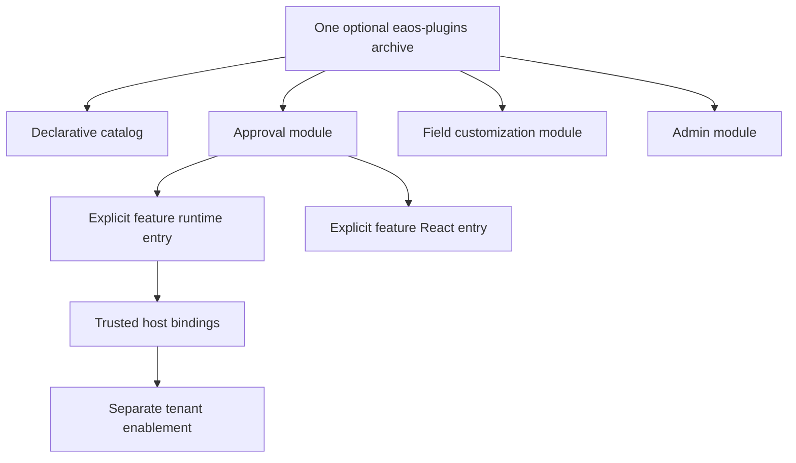

# Standard plugin collection architecture

## Motivation

The approval, field-customization and admin features share distribution ownership and an initial release lifecycle. One `@alneas/eaos-plugins` package reduces npm release targets to five while preserving the Core, Server, React and CLI boundaries. The collection remains optional for foundation consumers.

`plugins/package.json` owns distribution. `plugins/approval`, `plugins/field-customization` and `plugins/admin` keep their canonical source, tests, guides, runtime help and feature history without separate package manifests. Existing per-feature documentation routes remain stable.

## Architectural Diagram

## Trade-offs & Decisions

Install `@alneas/eaos-plugins`, then import a feature through its declared subpaths. For example, `@alneas/eaos-plugins/approval/runtime` supplies the approval extension factory, while `@alneas/eaos-plugins/approval/react` supplies its UI. There is no root runtime barrel. A subpath controls imports; npm still installs the collection's declared package dependencies.

Each feature builds into `dist/<id>/` with its own chunks and runtime/frontend inventory. Loading the selected server entry does not require importing all feature runtimes or a React entry. Browser applications use frontend entries and host API bindings rather than trusted server bindings.

`@alneas/eaos-plugins/catalog.json` is a declarative discovery asset. It does not import implementations, create routes, apply schemas or enable features. `preset.plugins` uses logical owners such as `@alneas/eaos-plugins/approval`, `@alneas/eaos-plugins/field-customization` and `@alneas/eaos-plugins/admin`; these are module selectors inside one installed package.

Code selection, host binding, schema application and tenant activation are separate operations. Missing live adapters fail closed. The host resolves current authenticated principals and checks tenant membership, lifecycle activation and resource authorization on each operation. Plugin IDs, CAS, durable audit and existing schema/migration identities retain their contracts.

This is the unpublished initial `0.1.0` candidate. The former three package names are replaced before publication; a retained source commit does not establish a published release or require a new version increment. Use exact reviewed archives for consumer verification and follow [release preparation](../../RELEASING.md) before any authorized publication.

Continue with the [collection overview](index.md), [approval host integration](../approval/docs/maintainer-guide.md), [field customization host integration](../field-customization/docs/maintainer-guide.md) and [admin host integration](../admin/docs/maintainer-guide.md).
