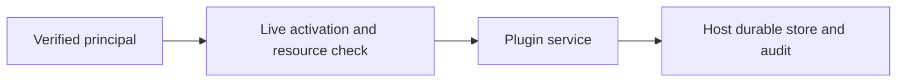

# field-customization host boundaries

## Motivation

The generic MIT field-customization plugin provides reusable operations while the host retains identity, current activation, persistence and resource authorization.

## Architectural Diagram



## Public import

Install `@alneas/eaos-plugins` once; `/field-customization` is this feature's import selector, not a separate npm package. Use Node.js 24 or later and Appkit Core exactly 0.2.0 with the declared EAOS Core/Server and Hono peers. Registry installation requires a published EAOS release; before publication use the owning workspace's checksum-verified build artifact.

```bash
bun add @alneas/eaos-plugins @alneas/appkit-core@0.2.0
```

```typescript
import { createPlugin } from '@alneas/eaos-plugins/field-customization'

export function bindHostPlugin(...args: Parameters<typeof createPlugin>) {
  return createPlugin(...args)
}
```

Server integration requires a verified principal resolver, live authorization and the plugin's durable host ports. React views use the separate `@alneas/eaos-plugins/field-customization/react` export. Install `@alneas/eaos-react`, `@alneas/appkit-react@0.3.0`, React/React DOM ^19.2.3 and Lucide React, import `@alneas/appkit-react/styles`, and supply authenticated API/session bindings plus the selected workspace and Appkit form/schema providers; importing the server entry requires no CSS.

## Trade-offs & Decisions

This feature belongs to the shared `@alneas/eaos-plugins` package. `preset.plugins` selects the logical module owner `@alneas/eaos-plugins/field-customization`; the declarative collection catalog only lists available modules. Package installation and module selection never activate a tenant. Request bodies cannot grant identity or roles. Real-store tests exercise persistence, tenant isolation, stale revisions and revocation. Business templates and production provider configuration remain host-owned.

Continue with the [user guide](user-guide.md), [host integration](maintainer-guide.md) and [API reference](api.md).
